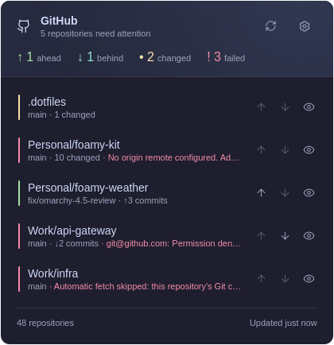

# Foamy GitHub

Local Git repository status, fetch, push, and pull.



## Install

Requires Omarchy 4.5 (also loads on 4.0.6, in English), Git, Python 3, Bash,
`jq` and `wl-clipboard`. Opening a repository requires `lazygit` and Omarchy's
terminal launcher; **Browse for folder** uses `qml6` and `hyprctl`.

```sh
omarchy plugin add https://github.com/foamrider/foamy-github.git --enable
```

## Use

1. Left-click the widget, open **Settings** (cog or `s`) and add your repository folders.
2. Choose how many levels deep to search each folder, and the refresh intervals.
3. Refresh (header button, `r`, or middle-click the widget) fetches remotes and updates status.
4. A repository's arrows push or pull; the terminal button (or Enter) opens it in lazygit.

The popup lists repositories that need attention: ahead, behind, changed, or
whose last fetch failed. A failed fetch is shown on the repository's row, in
red after its status line (for example `main · 10 changed · No origin remote
configured…`); hover it for the full message.

Keyboard: arrows or `hjkl` move one cursor through the rows, Refresh and
Settings (hovering moves the same cursor); Enter activates; `r` refreshes;
`s` opens Settings; Esc closes (or leaves Settings); Tab and Shift+Tab move to
the next bar panel.

## Settings

| Setting | Default | |
|---|---|---|
| Repository folders | none | Folders to search, each with a search depth of 0 to 5 levels (up to 32 folders) |
| Detect changes automatically | on | Updates through filesystem notifications (inotify); recommended |
| Refresh every | 30 seconds | Timed refresh; with automatic detection it is only the fallback. **Off** turns polling off |
| Fetch remotes every | 15 minutes | Background `git fetch` of every repository |
| Trust repository config | off | See [Trust model](#trust-model) |

Settings save in place (`bar.shell.updateEntryInline`, else `omarchy bar set`).

**Detect changes automatically** groups changes saved close together over
300 ms and checks only the affected repositories. Ignored dependency/build
directories and Git object stores aren't watched; Git worktrees and new
repositories within the search depth are picked up. Opening the popup doesn't
rescan while monitoring is live. If monitoring fails (for example, the system
watch limit is reached), the panel says so, uses the timed refresh, and
retries monitoring after 30 seconds, then 1, 2, 4… up to 30 minutes while it
keeps failing.

On Omarchy 4.5, which draws a bar on every monitor, the status helper,
filesystem watcher, timers and IPC target run once per shell, not once per
monitor.

## Trust model

The widget runs Git by itself, in every repository it finds: `status`,
`ls-files` and `rev-parse` on every change, and `git fetch` on a timer. A
repository's own Git config (`.git/config`, `config.worktree` and any file they
include) and its attributes can make Git run programs. A repository unpacked
from an untrusted archive into one of your folders could otherwise run code
just by being there.

So unless you trust repository config, every automatic Git command runs with
overrides that Git applies after all config files and includes. They are
passed as `GIT_CONFIG_COUNT`/`KEY`/`VALUE` pairs, so key names can't be
misparsed.

| Vector | Status checks | Automatic fetch |
|---|---|---|
| `core.fsmonitor`, untracked cache | off | off |
| Hooks (`core.hooksPath`, `.git/hooks`) | off (`/dev/null`) | off |
| Clean/smudge/process filters, including global ones such as Git LFS that the repository's attributes select (LFS reads repository settings like `lfs.extension.*`) | off for every defined filter | off |
| Submodule worktrees | not inspected | not fetched |
| `credential.helper` (repository-local) | — | ignored: the list is reset, then only your global/system helpers are added back |
| `core.sshCommand` (repository-local) | — | ignored, except a plain `ssh -i key`-style command (no shell syntax, safe `-o` options) |
| `core.askPass`, prompts | — | off: `GIT_ASKPASS=""` unless you set it, `SSH_ASKPASS_REQUIRE=never`, SSH `BatchMode` |
| `core.gitProxy` | — | off for repositories that set one |
| Transports (`ext::`, `fd::`, remote helpers, `remote.*.vcs`, `protocol.*`, every subsection spelling) | none | only http(s), ssh, git and file, plus helpers you allowed globally |
| On-demand fetches of missing objects from a promisor remote (partial clone) | off (`GIT_NO_LAZY_FETCH=1`, and no transport on older Git) | — |
| `remote.*.uploadpack` | — | `--upload-pack=git-upload-pack` |
| `http.*` / `remote.*.proxy` (proxy, TLS, CA, cookies, extra headers, resolve) | — | reset to your global value or Git's default |
| `core.alternateRefsCommand` | — | neutral |
| Automatic maintenance / gc (`gc.recentObjectsHook`, `maintenance.*`, `gc.auto`) | — | not run (`--no-auto-maintenance`) |
| Commit-graph write | — | off |

Include files (`include.path`, `includeIf`) are covered: the overrides come
after them. Your global Git config, credential helpers (for example `gh auth
git-credential`) and SSH agent keep working. Repository-local credential
helpers and unusual repository-local SSH commands don't apply to automatic
fetches: such a repository shows the authentication error on its row, and you
can fetch it in lazygit. A partial clone whose status needs a missing object
shows an error on its row instead of downloading it. Your global
`core.hooksPath` hooks don't run for automatic commands. Files tracked with Git LFS that you touched can count as
changed until Git refreshes its index. **Push and pull** are explicit actions
on one repository and run with its normal Git config and hooks, exactly like
`git push` in a terminal.

Requires Git 2.31 or later (`GIT_CONFIG_COUNT`); `--no-auto-maintenance`
needs 2.29.

Turn on **Trust repository config** only if you trust every repository in
these folders: the widget then uses each repository's config as is, like
before 1.1.

## Limits

Repository checks stream Git status without retaining file lists. A timeout,
resource limit or Git error shows **Status unavailable** for that repository
and disables push/pull until a fresh check succeeds; other repositories keep
updating. An incomplete folder scan reports an error; it never silently lists a
subset.

Checks allow 16 MiB of Git output and 15 seconds per status command, with at
most four commands at once. Folder discovery allows 256 repositories and
100,000 directory entries within five seconds per traversal. Monitoring allows
8,192 watches and 32,768 repository-to-directory associations. Shell messages
and cached sync state are limited to 8 MiB. Pull requires a clean, non-diverged
branch with an upstream and is fast-forward only. Works with any Git host.

Repository-folder paste reads at most 16 KiB with a two-second deadline.

## Remove

```sh
omarchy plugin remove foamy.github
```

Removal stops repository monitoring and scheduled fetches (the helpers stop
their Git processes when the shell stops them). Your repositories,
Git configuration, authentication, and cached status remain on disk.

Omarchy manages the plugin entry in `shell.json`. Packages and data outside
the plugin directory are retained unless you remove them separately.

## License

Licensed under [MIT](LICENSE), with [Omarchy](LICENSE-OMARCHY) and
[Lucide](LICENSE-LUCIDE) notices.

Provided **as is**, without warranty or guaranteed support. Use at your own risk.

## Language

Language follows **Omarchy → Setup → Language** on Omarchy 4.5 (English and
Norwegian catalogs; other languages fall back to English). Omarchy 4.0 shows
the plugin in English.

## Development

`kit/` holds shared components copied from [foamy-kit](https://github.com/foamrider/foamy-kit); edit them there, not here.

```sh
node --test tests/model.test.js tests/preferences.test.js && node tests/i18n.test.cjs
python3 -m unittest discover -s tests -p 'test_*.py'
bash tests/kit-check.sh
python3 tests/i18n-runtime.py                     # OMARCHY_PATH=<4.5 tree> for 4.5
python3 tests/runtime-panel.py                     # offscreen, needs foamy-kit
~/GitHub/Personal/foamy-kit/preview/render.py . --host both
```

Shared components in `kit/` come from [foamy-kit](https://github.com/foamrider/foamy-kit);
don't edit them here.
